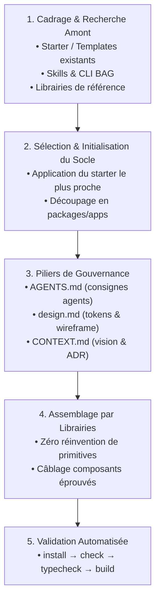

# Project & Environment Setup

## Activer ce skill
Utiliser lorsque vous démarrez un nouveau projet, initialisez un monorepo ou un dépôt standard, restructurez une application à partir d'un prototype, ou installez le socle de gouvernance agentique (`AGENTS.md`, `design.md`, `CONTEXT.md`).

---

## Les Trois Règles d'Or

### 1. Recherche Amont Systématique (Upstream Discovery First)
Avant d'écrire la moindre ligne de code ou de créer manuellement des fichiers de plomberie :
- **Rechercher les templates & starters officiels** : Vérifier si un starter très proche de la cible existe (ex. starters officiels Turborepo, Next.js templates, starters shadcn/ui, Better-T-Stack).
- **Rechercher dans le catalogue BAG & Skills** : Vérifier si des recettes, des packs ou des CLI existants couvrent déjà le déploiement ou l'outillage (`bag search`, `bag loadout`).
- **Identifier les librairies éprouvées** : Interdiction formelle de recoder à la main des briques que l'écosystème résout déjà de manière robuste (composants headless, formulaires, state management, graph/canvas, persistance, auth).

### 2. Minimisation Stricte du Code Custom
- Le code fait main représente une dette de maintenance immédiate.
- Ne coder manuellement **que le delta métier et l'orchestration spécifique** au produit.
- Si une maquette ou un wireframe HTML/CSS est fourni, mapper ses éléments vers des primitives de design system standard (ex. Radix UI, Lucide icons, Tailwind) plutôt que de recréer du CSS ad-hoc.

### 3. Gouvernance du Dépôt Dès le Jour 0
Un projet prêt pour le pair programming autonome avec des agents IA doit obligatoirement comporter trois documents directeurs au root :
- **`AGENTS.md`** : Guide opérationnel, consignes d'architecture, commandes de validation et garde-fous pour les agents IA.
- **`design.md`** : Tokens de design, règles de layout, typographies (`mono`, `sans`), et conventions d'interface.
- **`CONTEXT.md`** : Vision produit, user stories cibles, décisions d'architecture actées (ADR immuables).

---

## Workflow Étape par Étape



### Étape 1 : Cadrage & Recherche Amont
1. **Analyser l'intention et le prototype** : Lister les fonctionnalités nécessaires (UI, base de données, auth, workflows, canvas, API).
2. **Scanner l'existant** :
   - Starters : `create-turbo`, `create-next-app`, templates officiels Vercel / Better-T-Stack.
   - BAG : `node packages/cli/bin/bag.mjs search <mot-clé>` pour identifier skills, MCP et templates réutilisables.
   - Librairies spécialisées :
     - Canvas & Graphes : `@xyflow/react` (React Flow).
     - Primitives UI : `@radix-ui/*`, `clsx`, `tailwind-merge`, `lucide-react`.
     - Persistance : `drizzle-orm` + `drizzle-kit`.
     - Auth : `better-auth`.
     - Orchestration IA : `ai` (Vercel AI SDK).

### Étape 2 : Initialisation du Socle
1. Si un starter correspond à > 70% du besoin, l'initialiser directement.
2. Sinon, configurer un monorepo pnpm + Turborepo propre :
   - `apps/web` : Application frontend / SSR.
   - `packages/core` : Types et contrats de domaine partagés.
   - `packages/db` : Schéma ORM, migrations, seed.
   - `packages/ui` : Primitives de design réutilisables.
   - `packages/config-typescript` : Bases tsconfig partagées.
3. Configurer le gestionnaire de paquets (`pnpm-workspace.yaml`, `.npmrc`).
4. Configurer la chaîne de qualité : `biome.jsonc` ou `eslint/prettier`, `turbo.json`.

### Étape 3 : Déploiement des Piliers de Gouvernance
Créer ou mettre à jour les fichiers de gouvernance depuis les modèles fournis dans `references/` :
- [AGENTS.md](references/AGENTS.md.template)
- [design.md](references/design.md.template)
- [CONTEXT.md](references/CONTEXT.md.template)

### Étape 4 : Assemblage & Câblage
1. Installer les librairies sélectionnées via le gestionnaire de paquets de l'espace de travail :
   ```bash
   pnpm add <librairie> --filter <cible>
   ```
2. Câbler les interfaces et les données sans réinventer de composants génériques.
3. Isoler les modules spécifiques côté serveur (`client.ts` avec drivers Node.js) des paquets consommés par les Client Components React pour éviter les erreurs de packaging webpack.

### Étape 5 : Validation Automatique Continue
Vérifier systématiquement l'intégrité du projet à chaque étape :
```bash
# 1. Résolution des dépendances
pnpm install

# 2. Vérification du lint et du format
pnpm check

# 3. Vérification du typage strict
pnpm typecheck

# 4. Compilation et build de production
pnpm build
```

---

## Critères d'Acceptation & Livrables
- [ ] La recherche amont de templates et librairies est explicitée dans la PR ou les notes de cadrage.
- [ ] Le code custom manuel est strictement limité au domaine métier spécifique.
- [ ] `AGENTS.md` est présent et décrit les commandes de validation et les règles de structure.
- [ ] `design.md` répertorie les tokens CSS, polices et composants clés.
- [ ] `CONTEXT.md` consigne la vision et l'historique append-only des décisions (ADR).
- [ ] L'ensemble des commandes de validation (`check`, `typecheck`, `build`) réussit avec 0 erreur.
